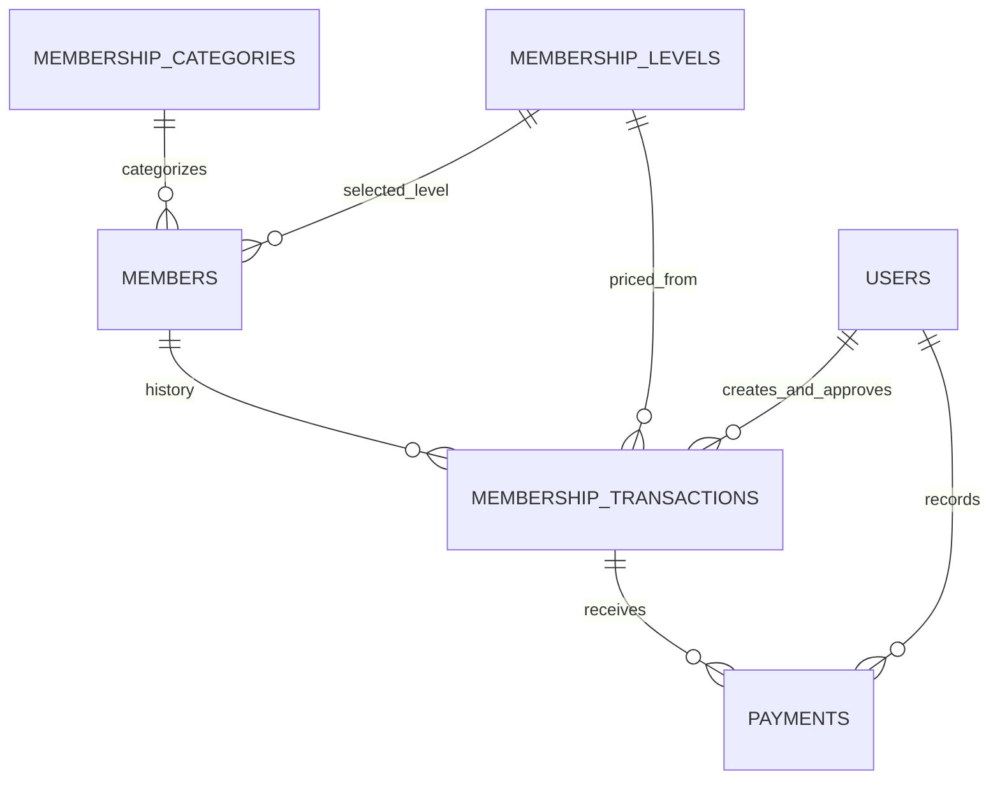
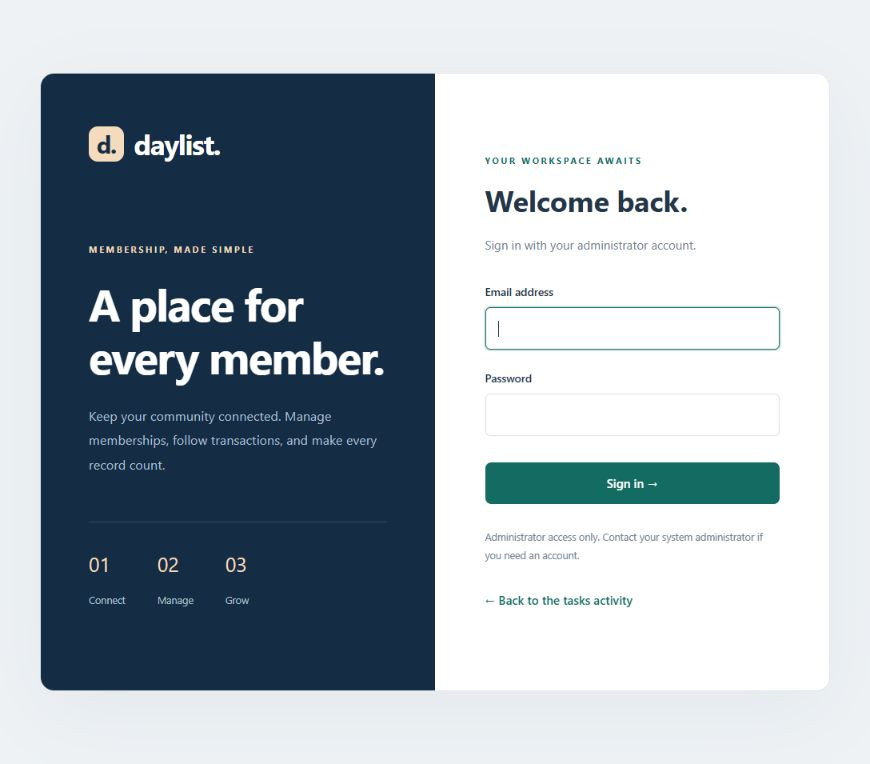
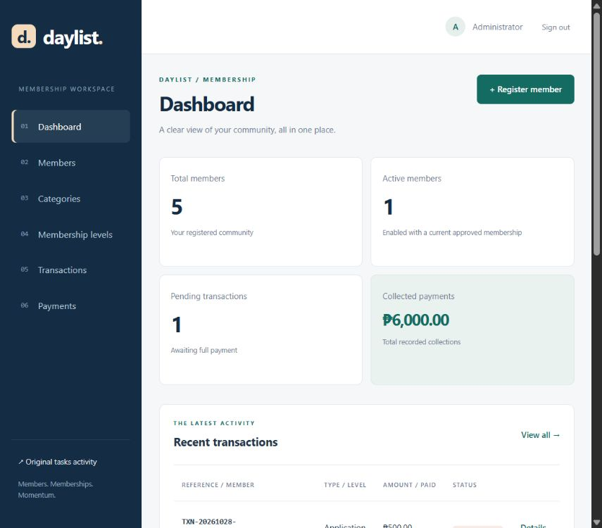
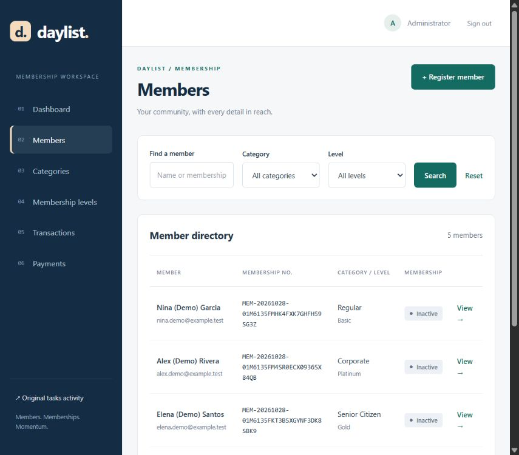
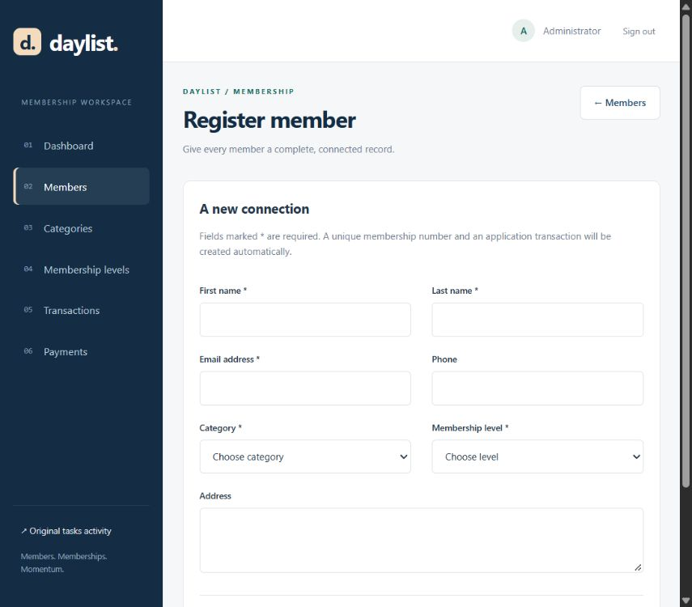
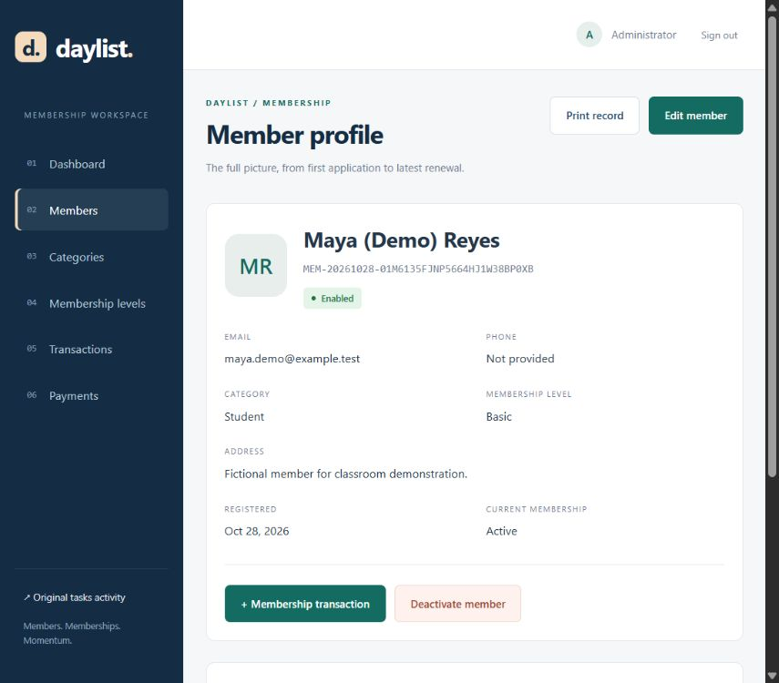
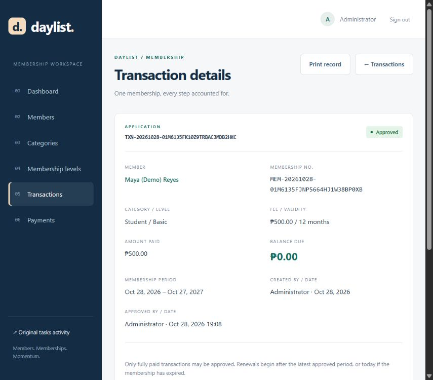
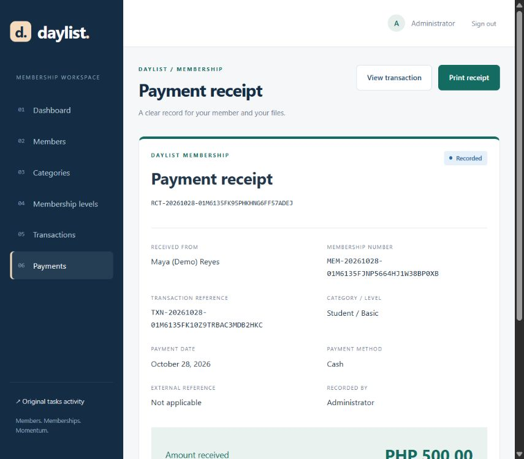

# Daylist: Membership Management and Transaction Processing

A Laravel 12 / PHP 8.2 application extending the original Tasks activity in the same project and the same `laravel_tasks` MySQL database.

## Installation

Requirements: PHP 8.2+, Composer, and MySQL/MariaDB (available in XAMPP). No Node.js build is required; CSS and JavaScript are served directly from `public/`.

1. Start **MySQL** in XAMPP. Create an empty **laravel_tasks** database in phpMyAdmin. Start Apache too if using phpMyAdmin or the existing Apache URL.
2. In the project folder, run the following for a **new installation**:

   ```powershell
   composer install
   Copy-Item .env.example .env
   php artisan key:generate
   ```

   Preserve your existing `.env` when updating an installation.

3. Check the database configuration in `.env`:

   ```dotenv
   DB_CONNECTION=mysql
   DB_HOST=127.0.0.1
   DB_PORT=3306
   DB_DATABASE=laravel_tasks
   DB_USERNAME=root
   DB_PASSWORD=
   APP_TIMEZONE=Asia/Manila
   ```

   Use your own MySQL password if configured. Then run:

   ```powershell
   php artisan config:clear
   php artisan migrate --seed
   php artisan membership:admin professor@example.com --name="Professor"
   php artisan serve
   ```

   The administrator command prints a randomly generated password. Save it privately. Existing accounts are never overwritten; use another email for an additional administrator.

4. Open **http://127.0.0.1:8000/login**. The existing XAMPP Apache URL is **http://localhost/myproject/public/login**.

Membership pages require an administrator session. There is no public administrator registration. The original activity remains at `/tasks`, `/tasks/15`, and `/about`; the welcome route `/` is retained. Use **Membership** in the task navigation or **Original tasks activity** in the membership sidebar to switch activities.

## Database snapshot

`database/laravel_tasks.sql` contains the complete table schema and a snapshot of saved task and membership records. User passwords are hashed. Live sessions, cache entries, queued jobs, and password-reset tokens are omitted from the exported data.

For a **new installation**, choose either the migrations above or import this SQL snapshot through phpMyAdmin. The snapshot recreates tables, so import it only into a new database or after backing up existing data. Configure `.env`, run `php artisan key:generate`, `php artisan config:clear`, and `php artisan migrate`, then create your own administrator using `membership:admin`. The existing administrator's plaintext password is not stored in this repository.

The SQL file is a snapshot; future changes do not update it automatically. Do not run `migrate:fresh` on records you want to preserve.

## Categories, levels, and fictional demo records

`MembershipSeeder` creates Student, Regular, Senior Citizen, and Corporate categories and Basic, Silver, Gold, and Platinum levels. Initial fees are **sample PHP amounts** of 500, 1,000, 2,000, and 3,500, each valid for 12 months. Administrators can edit fees, validity, and benefits. Re-running the seeder preserves existing settings.

The local database and submission snapshot include five fictional members labeled **(Demo)** with `example.test` emails. They demonstrate Pending, Paid, Approved, Expired, and Cancelled transactions. Collections are sample records, not real payments. A fresh migration installation starts without members. Add optional demonstration records after creating an administrator:

```powershell
php artisan db:seed --class=DemoMembershipSeeder
```

## Demonstration walkthrough

1. Sign in and review total members, active members, pending transactions, and collected payments.
2. Create or edit categories and levels. A level stores its fee, validity in months, and benefits.
3. Register a member with first/last names, a valid unique email, category, and level. A unique membership number and application reference are generated automatically.
4. Search by full name or membership number and combine category/level filters. Open a profile to edit details and view history.
5. Open the pending application. Approval before payment is rejected by the server.
6. Record a partial payment: balance decreases and status stays Pending. Pay the remainder: status becomes Paid. Bank transfer/e-wallet payments require an external reference.
7. Approve the fully paid transaction. The record stores its approver, approval timestamp, and membership dates.
8. Create a Renewal, pay it, and approve it. Current memberships extend after the latest approved period; expired memberships restart today.
9. Open a payment and choose **Print receipt**. Member and transaction records are printable too. Browser printing / Save as PDF hides navigation and action buttons.
10. Deactivate a member. History remains available; new transactions, payments, and approvals are blocked until reactivation.

## Processing rules

- Each member belongs to exactly one category and one selected level, enforced with foreign keys.
- Member details and membership numbers are editable. Validation and unique indexes reject duplicate membership numbers and emails.
- Member deletion uses deactivation, preserving history. Reactivation is available on the profile.
- Each member may have one unfinished transaction (Pending or Paid). Applications are for new memberships; members with a previously approved membership use Renewal.
- Each transaction snapshots its level fee and validity. Editing a level does not change existing charges or periods.
- Payments must belong to an existing pending transaction, be positive, use at most two decimal places, and not exceed the remaining balance. Dates cannot be in the future or before transaction creation.
- Money comparisons use integer centavos; MySQL stores fixed-precision decimals.
- Fully paid transactions become Paid and can then be Approved. Zero-fee transactions start Paid without requiring a payment. Paid alone does not activate membership.
- Approval creates an inclusive period: start plus calendar-month validity, minus one day. Month-end calculations prevent overflow.
- Expired is an effective status derived from an approved transaction's end date. Lists, filters, and the dashboard use the same date rules. No scheduler is required; the database retains `approved` as the historical approval state.
- Active members are enabled members with an approved period covering today. A future renewal alone does not count as current membership.
- Only pending transactions without payments can be cancelled. Payments cannot be edited/deleted through the application. Refunds, reversal accounting, and payment gateways are outside this activity.
- Assigned categories and historically used levels cannot be deleted. Foreign keys prevent orphaned records.
- Database transactions and member/transaction row locks serialize payment, approval, cancellation, and transaction creation in MySQL.

## MVC structure

| Component | Implementation |
| --- | --- |
| Authentication | Laravel session guard, password hashing, CSRF, session regeneration, login rate limiting, administrator middleware |
| Members | `Member`, `MemberController`, member forms/list/profile views |
| Categories | `MembershipCategory`, `CategoryController`, shared catalog view |
| Levels | `MembershipLevel`, `LevelController`, fee/benefits/validity fields |
| Transactions | `MembershipTransaction`, `TransactionController`, shared `MembershipService` |
| Payments | `Payment`, `PaymentController`, recording form and printable receipt |
| Dashboard | `DashboardController`, totals and recent activity |
| Storage | Additive migrations, Eloquent relationships, foreign keys, unique references |
| Original activity | Existing Task model, controller, migration, views, and routes retained |



`membership_transactions` stores references, type, fee/validity snapshots, status, membership dates, creator, and approver. `payments` stores receipt number, transaction key, amount, method, external reference, payment date, and recorder. Tables have timestamps. Original task records remain independent in `tasks`.

## Verification

```powershell
php artisan test
php artisan route:list --except-vendor
php artisan migrate:status
php vendor/bin/pint --dirty --test
```

Tests use isolated in-memory SQLite and never clear local MySQL. They cover the original activity, authentication/authorization, CRUD/search, duplicate identifiers, catalog protection, partial/full payments, overpayments, unpaid approval rejection, renewals, cancellation, expiration, free levels, and page rendering.

Live HTTP verification against MySQL also exercised login, registration, unpaid approval rejection, partial/final payments, receipt rendering, approval, renewal, search, history, dashboard, and the original tasks page. Temporary verification records were removed afterward.

## Rubric evidence

| Area | Evidence |
| --- | --- |
| Setup / connection (15) | MySQL migrations, connected models, SQL snapshot, setup guide |
| Member CRUD (20) | Registration, profile, edit, deactivate/reactivate, validation, combined search |
| Categories / levels (15) | CRUD, assignments, fees, validity, benefits, deletion protection |
| Transaction processing (20) | Applications, renewals, payments, approval rules, statuses, history, receipts |
| Database design (10) | Normalized relationships, foreign keys, unique references, audit user keys |
| Interface (10) | Responsive workspace, empty/error states, badges, print stylesheet |
| Code quality (5) | MVC, shared service, validation, tests, Pint formatting |
| Documentation (5) | Installation, schema, walkthrough, screenshots |

## Screenshots

Captured from the running application using fictional demo records. Scrollable pages show the browser viewport.

### Login



### Dashboard



### Members



### Registration



### Profile



### Transaction



### Receipt



## Troubleshooting

- Connection refused: start MySQL and confirm its port matches `.env`.
- Unknown database: create `laravel_tasks` before migrating.
- Missing tables: run `php artisan migrate --seed`.
- Old configuration: run `php artisan config:clear`.
- Login fails: use credentials printed by `membership:admin`; non-administrators cannot sign in to this workspace.
- Deletion blocked: the category or level is assigned or part of history. Reassign unused categories or retain the historical level.
- Payment rejected: check balance, enabled member status, payment date, and transaction status.

Framework references: [Laravel authentication](https://laravel.com/docs/12.x/authentication) and [query locking](https://laravel.com/docs/12.x/queries#pessimistic-locking).
